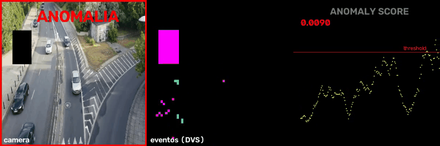

# SNN-Anomaly

Detecção de anomalias em vídeo com um **autoencoder de spikes**: a rede aprende a reconstruir os padrões de eventos "normais" de uma cena — erro de reconstrução alto = algo nunca visto = anomalia.



## Como funciona

```
video -> eventos ON/OFF (DVS simulado) -> event frames 2x64x64
      -> encoder SNN (conv-LIF x3) -> latente (membrana média)
      -> decoder -> reconstrução
      -> MSE(input, output) > threshold -> ANOMALIA
```

- **Zero labels**: treino não-supervisionado, só com cena normal (tráfego)
- **Threshold calibrado** automaticamente (média + 4σ do baseline)
- Bottleneck pequeno força o modelo a reter apenas padrões de movimento normais

## No demo

Um objeto piscando (strobe) cruza a cena — nos eventos ele aparece como um bloco denso ON/OFF que o modelo nunca viu → score sobe acima do threshold → borda vermelha de alerta.

## Uso

```bash
pip install -r requirements.txt

# dataset de eventos normais a partir de videos
python -m src.make_data video1.mp4 video2.mp4 ...

# treino
python -m src.train --epochs 40

# demo (injeta anomalia sintetica em ~40-70% do video)
python -m src.demo video.mp4 -o demo/anomaly.mp4
```

## Por que SNN aqui

Vigilância/QC é 99% "nada acontecendo". Uma rede de pulsos só gasta computação quando há spikes — inferência quase gratuita no cenário normal, que é exatamente a distribuição desses sistemas.

Quarto projeto da série de computação neuromórfica:
[snn-ocr](https://github.com/vsousadelvek/snn-ocr) ·
[snn-gesture](https://github.com/vsousadelvek/snn-gesture) ·
[snn-tracker](https://github.com/vsousadelvek/snn-tracker)
